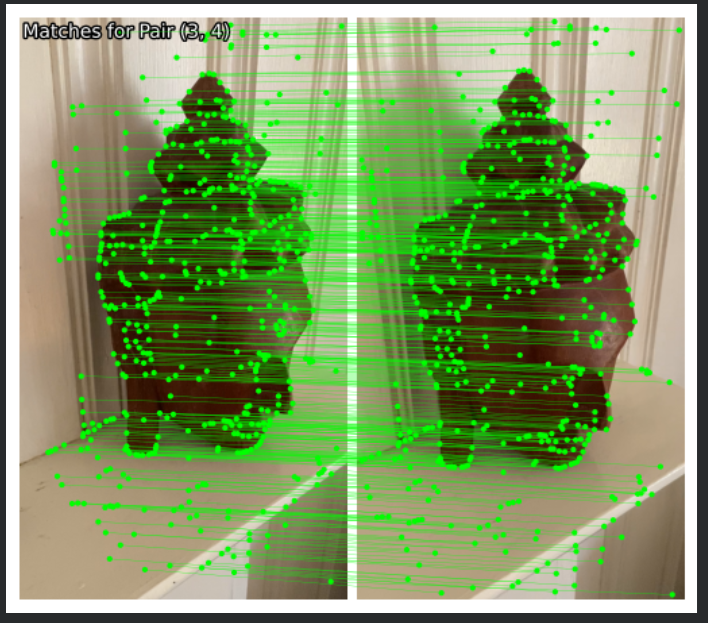
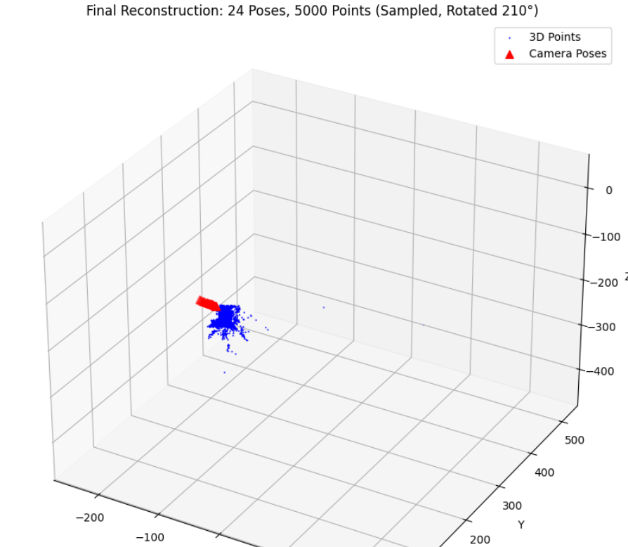
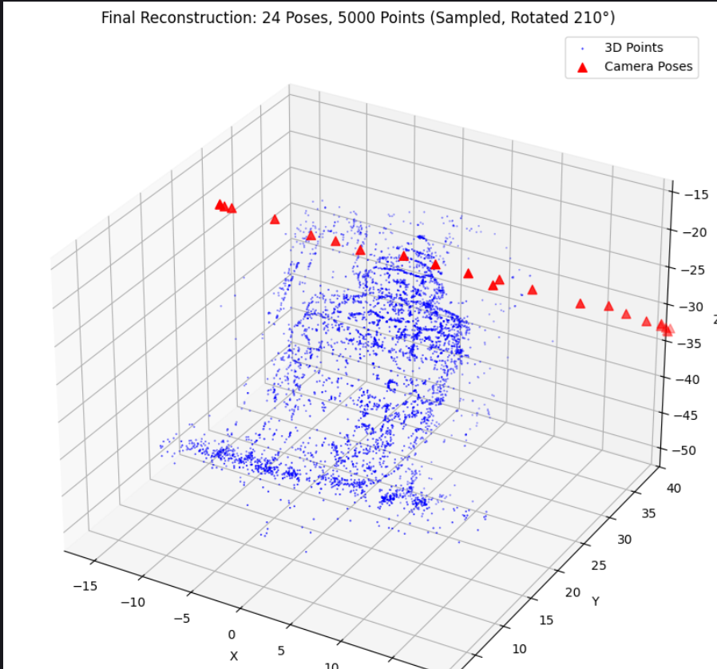

# Structure from Motion: Feature Extraction & Matching

## Overview
This project implements the foundational steps of a Structure from Motion (SfM) pipeline. It focuses on identifying and matching keypoints across a series of images to enable 3D reconstruction. Utilizing state-of-the-art deep learning architectures, the notebook demonstrates how to extract robust local features and pair them across temporal or spatial image sets. 

The pipeline utilizes **SuperPoint** for dense, repeatable feature extraction and **LightGlue** for highly accurate, fast feature matching. The notebook is designed to process batches of images, cache extracted tensors, and visualize the geometric verifications between pairs.

## Keywords
`Structure from Motion (SfM)` `Computer Vision` `Feature Extraction` `Feature Matching` `LightGlue` `SuperPoint` `PyTorch` `GTSAM` `Deep Learning` `Image Processing`

## Features
* **Advanced Feature Extraction:** Uses the SuperPoint neural network to detect keypoints and compute descriptors directly on the GPU.
* **Robust Matching:** Implements LightGlue to match extracted features across consecutive image pairs, factoring in a configurable temporal lookahead window.
* **Optimized Pipeline:** Designed with local caching (`.pt` files) to prevent redundant feature extraction during subsequent runs.
* **Visualization:** Built-in `viz2d` support to visually verify matches between image pairs. 

## Tech Stack
* **Language:** Python 3
* **Libraries & Frameworks:** PyTorch, TorchVision, OpenCV (cv2), LightGlue, GTSAM, Matplotlib, Plotly
* **Environment:** Google Colab (with Google Drive integration for dataset storage)

## Workflow
1. **Environment Setup:** Installs necessary dependencies and clones the official `cvg/LightGlue` repository.
2. **Data Loading:** Mounts Google Drive and defines directory paths for the source images and the local feature cache.
3. **Feature Extraction:** Iterates through the image dataset, extracts raw features using SuperPoint, removes the batch dimension for efficiency, and saves the cleaned tensors to the cache.
4. **Feature Matching:** Loads the cached features, structures them into paired permutations with a defined temporal window (e.g., matching image $i$ with images $i+1$ to $i+6$), and processes them through the LightGlue matcher.
5. **Verification & Visualization:** Filters matches based on an inlier threshold and plots the connected keypoints to visually verify accuracy.

## Results

### Feature Extraction and Matching
Visualization of robust keypoint matching across consecutive image pairs using SuperPoint and LightGlue. 

---

### 3D Reconstruction (Before Bundle Adjustment)
The initial 3D point cloud and camera pose estimates prior to optimization. Notice the noise in the point cloud and the tightly clustered camera poses.

---

### Final 3D Reconstruction (After Bundle Adjustment)
The optimized 3D structure and refined camera trajectories after applying Bundle Adjustment. The geometric structure is significantly cleaner, and the calculated camera poses accurately reflect the camera's movement around the object.

## Setup & Usage
Ensure you have the required dataset structure in your Google Drive before running the notebook. 

1. Update the `BASE_DIR` in the notebook to point to your specific dataset folder (default is `/content/drive/MyDrive/3D_recon`).
2. Run the notebook sequentially. The script will automatically install missing dependencies (like `gtsam` and `lightglue`).
3. Images should be in `.png` format inside the `data` sub-directory.
4. Extracted features will be saved in the `features/` directory as PyTorch tensor files (`.pt`).
